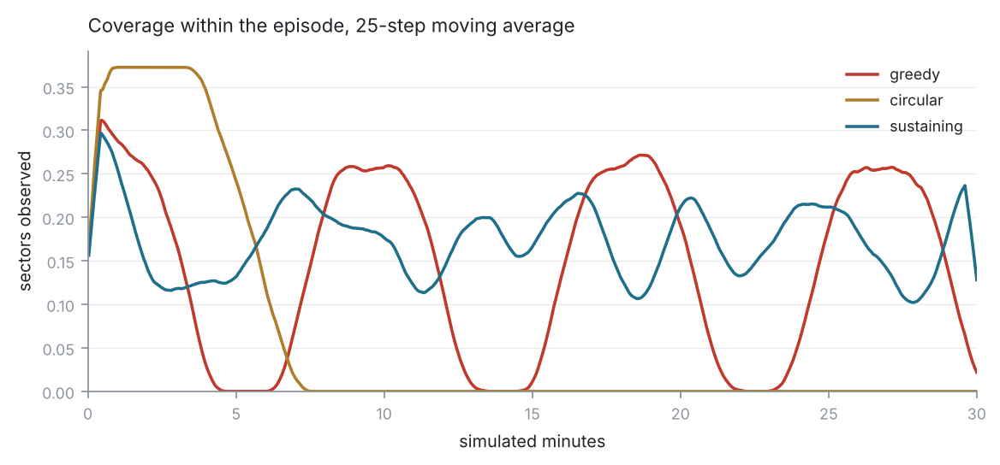
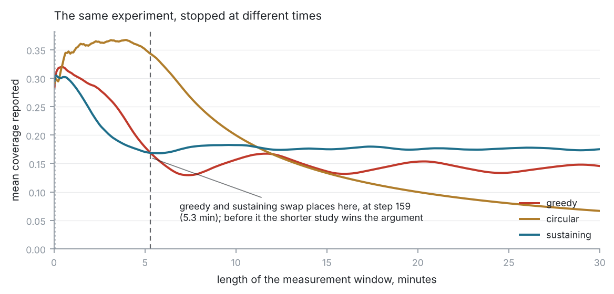

# paired-rl-eval

Measurement tooling for multi-agent reinforcement learning: paired comparison
with common random numbers, bit-exact rewind, and a visibility threshold
printed beside every difference so you can tell a result from a rounding error.

It ships with a small persistent-surveillance environment and three hand-written
policies, because a measurement harness needs something to measure. The
environment is the demonstration, not the contribution.

```bash
pip install -e ".[dev]"
python examples/02_window_flip.py
pytest
```

No dependencies beyond `numpy`; `matplotlib` only to redraw the figures. The
headline comparison below — 32 worlds, 900 steps, two policies — takes 1.8 s.

---

## The problem

Two policies. One measurement each. Both measurements correct.

```
100 steps: greedy +0.2527 -> sustaining +0.1940 | diff -0.0587 | t -16.93 | B worse
900 steps: greedy +0.1430 -> sustaining +0.1750 | diff +0.0320 | t +46.04 | B better
```

Nothing was cherry-picked and no seed was hunted for. The two runs disagree
because they stopped at different times, and the stopping time was never
reported as a parameter — it was buried in a config file as `episode_length`.



The top figure is why. Within a single episode the policies take turns; a
number averaged over the first N steps is a weighted average of that
oscillation, and which policy it favours depends on N.



`flip_point` reports the **last** window length at which the ranking changes
hands, not the first. The first is the easy number to quote and the wrong one
to act on: on an earlier version of these policies the ranking changed hands
four times, and the first crossing was at step 76 while the answer that
survived to the end of the horizon was step 165.

---

## What the package does

```python
from pairedeval import Greedy, Sustaining, paired_compare, flip_point

r = paired_compare(Greedy(), Sustaining(), steps=900, batch=32, seed=0)
print(r.diff, r.visibility, r.visible, r.verdict)

flip_point(Greedy(), Sustaining(), steps=900)   # 159
```

**Paired measurement.** Both arms run on the same worlds, from the same state,
with the same random draws. `snapshot()` deep-copies every array *and* the
generator's bit state; `restore()` rewinds to it exactly. The sharpest test of
this is in the suite: a policy compared against itself returns a difference of
exactly `0.0` with a standard error of exactly `0.0`.

**A visibility threshold on every result.** `Result.visibility` is two standard
errors — the smallest effect the measurement could have resolved. `verdict`
says `indistinguishable from zero` when the difference does not clear it. The
threshold is computed from the measurement, not chosen after seeing the result.

**Window profiling.** `trace`, `profile`, `crossings` and `flip_point` report a
metric as a function of how long you measured, which turns the stopping time
from a hidden parameter into a reported one.

**An unpaired comparison, kept on purpose.** `unpaired_compare` does the same
job carelessly, on independently sampled worlds. Running both is the clearest
argument for pairing that exists — and, as it turns out, the clearest argument
for not overselling it.

---

## Pairing is not a free win

Common random numbers remove the variance the two arms *share*, so they help in
proportion to how alike the arms are. `examples/04_when_pairing_pays.py`
measures the whole curve:

| arms differ by | paired s.e. | unpaired s.e. | gain |
|---|---|---|---|
| nothing (same policy) | 0.00000 | 0.00164 | exact |
| 0.5 pp return threshold | 0.00050 | 0.00166 | 3.3× |
| 1 pp | 0.00048 | 0.00170 | 3.5× |
| 2 pp | 0.00061 | 0.00169 | 2.8× |
| 5 pp | 0.00082 | 0.00171 | 2.1× |
| 10 pp | 0.00100 | 0.00172 | 1.7× |
| sustaining ablation | 0.00121 | 0.00183 | 1.5× |
| greedy vs sustaining | 0.00177 | 0.00188 | 1.1× |
| greedy vs circular | 0.00360 | 0.00383 | 1.1× |

Running an ablation or a hyperparameter sweep, pairing is worth two to three
times the resolving power. Comparing a trained policy against a hand-written
baseline it buys close to nothing, and it is not even reliably non-negative:
across 30 seeds of `Greedy` against `Sustaining` at 300 steps, the paired
standard error was the narrower one in 12, with a median ratio of 0.98 and a
worst case of 1.8× *wider*. An earlier version of the test suite asserted that
pairing never enlarges the error bar. That assertion is false, and the suite
caught it.

On near-identical arms the difference between the two methods is the difference
between seeing an effect and missing it:

```
paired    diff -0.00299   visibility 0.00201   -> B worse
unpaired  diff -0.00369   visibility 0.00438   -> indistinguishable from zero
```

---

## Prior work, and what this is not

Common random numbers are a textbook variance-reduction technique from
discrete-event simulation, decades older than this repository. Nothing in the
method here is new, and the literature on it is both current and stronger than
the empirical finding above.

**Using Common Random Numbers for Simulation-based Planning with Rollouts**
(Reinforcement Learning Journal, 2026) proves what `examples/04` only measures:
CRN does not always reduce variance. It gives a counterexample and proposes a
depth-dependent estimator with an actual variance guarantee. If you need the
result rather than the demonstration, read that paper, not this code.

**When Does Pairing Seeds Reduce Variance? Evidence from a Multi-Agent Economic
Simulation** (arXiv 2512.24145) asks the exact question `examples/04` answers,
in a multi-agent setting, and ties the gain to seed-level correlation between
the arms. Same conclusion, arrived at independently and reported first.

**Empirical Design in Reinforcement Learning** (JMLR 25, 2024) and **Deep
Reinforcement Learning at the Edge of the Statistical Precipice** (NeurIPS 2021)
are the standard references for how to report an RL result at all — sample
sizes, interval estimates, and what a handful of seeds can and cannot support.
Read those before deciding what to claim from any measurement, including one
made with this package.

So this repository is not a methodological contribution and should not be cited
as one. It is a small, dependency-light, fully deterministic implementation with
a worked demonstration of two things that are easy to say and harder to show:
that a ranking can depend on how long you measured, and that pairing stops
paying once the two arms stop resembling each other. The tests are the point —
including the two that are deliberately aimed at claims this repository got
wrong, below.

---

## Two claims this repository got wrong

Both are documented in place rather than quietly corrected, and both have a
test pointing at them so they cannot come back.

**"Travel energy is what punishes the greedy policy."** The environment was
built around it: power is split into a hover term and a cruise term so that
crossing the site costs more than holding station. Setting `cruise_w=0` refutes
it — with travel free the reversal survives, later and *wider* (+0.046 against
+0.032). What the travel cost actually does is sharpen the greedy policy's
early lead, from −0.009 to −0.061 at 100 steps. It makes the reversal more
dramatic; it does not cause it.

**"The winning policy sustains a better duty cycle."** It flies *less*: 0.48 of
the episode airborne against the greedy policy's 0.53.

The mechanism is sensor overlap, and `examples/03_ablation.py` measures it
directly instead of inferring it from coverage:

| policy | aircraft per observed sector |
|---|---|
| greedy | 1.31 |
| sustaining | 1.01 |
| sustaining, partition removed | 1.15 |

Agents that chase the globally stalest sector converge on the same ground and
watch it together — about a quarter of the fleet's sensor capacity spent
duplicating a neighbour. The waste is invisible early, while staleness is still
uniform and the agents are still spread out, and it builds as the staleness
field develops. That delay is the whole phenomenon.

Removing both of `Sustaining`'s mechanisms costs more than removing each
separately (−0.0423 against a sum of −0.0258): they hold each other up.

---

## Layout

```
pairedeval/
  env.py        SwarmEnv + Config; snapshot/restore; vectorised over a batch
  policies.py   Greedy, Circular, Sustaining (with ablation switches)
  paired.py     paired_compare, unpaired_compare, Result
  profile.py    trace, profile, crossings, flip_point
examples/
  01_paired_vs_unpaired.py    what pairing buys on a small effect
  02_window_flip.py           the same comparison, two windows, two answers
  03_ablation.py              which mechanism does the work, measured
  04_when_pairing_pays.py     where common random numbers stop helping
  make_figures.py             redraws the two figures above
tests/
  test_determinism.py   rewind is bit-exact; pairing behaves as claimed
  test_window.py        the reversal, and the two refuted explanations
```

## Using it on your own policy

Implement `act(env) -> (target_xy, go_home)` and give the object a `name`.
Anything in the package accepts it:

```python
class MyPolicy:
    name = "mine"
    def act(self, env):
        ...   # (batch, n_agents, 2) targets, (batch, n_agents) bool
```

To measure something other than coverage, pass `metric=` — the environment
returns `coverage`, `mean_staleness`, `max_staleness`, `soc` and `airborne`
from every step.

---

## Background

The harness generalises the measurement chain from my doctoral work on
energy-aware UAV swarm surveillance (Faculty of Electronic Engineering,
University of Niš), where meta-learned and ablated policies had to be compared
under a fixed compute budget and differences were small enough that the
measurement method decided the conclusion. The environment here is a
stand-alone miniature; none of the thesis results depend on it.

MIT licensed.
